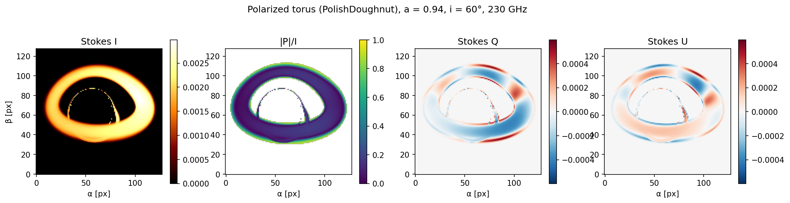

# BlackLightPlus

GPU-accelerated general-relativistic ray tracing and fully polarized radiative
transfer in **arbitrary spacetimes**, written in Julia.

[](https://github.com/FoAKTEE/BlackLightPlus/actions/workflows/CI.yml)
[](https://foaktee.github.io/BlackLightPlus/dev/)
[](LICENSE)



*Stokes I, linear polarization fraction |P|/I, Q and U of an analytic
magnetized torus (`PolishDoughnut`, pressure maximum at r = 9 M) around a Kerr
black hole with a/M = 0.94, at 230 GHz and i = 60°, 128² pixels, from the
polarized reverse march. Produced by [`figures/fig_examples.jl`](figures/fig_examples.jl).*

A single code path renders images from analytic metrics, superposed
Kerr–Schild binaries, and numerical-relativity spacetimes, on CPU and GPU, with
automatic differentiation through the entire pipeline.

## Capabilities

- **Geodesics** — Hamiltonian null geodesics in covariant-momentum form
  (`trace_rays_sampled`), with an exact-Kerr elliptic fast path and lensing
  bands (`lensing_band`, `photon_ring_layers`).
- **Arbitrary spacetimes** — any analytic metric via AD (`UserMetric`), binary
  black holes (`SuperposedKerrSchild`), and real numerical-relativity slices
  from AthenaK Z4c dumps (`z4c_grid_spacetime`).
- **Radiative transfer** — full IQUV transport in a parallel-transported camera frame, with
  thermal, power-law, and kappa synchrotron emission, Faraday rotation and
  conversion, and R_high/R_low electron temperatures (`render`).
- **GPU** — fused single-kernel imaging with geodesics, fluid sampling, and
  transfer all on device; native AMR meshblock sampling; multi-GPU
  (`render_gpu_amr`, `render_gpu_amr_polarized`).
- **Differentiability** — forward AD (ForwardDiff, including inside GPU
  kernels) and reverse AD (Enzyme) through the radiation chain
  (`render_gpu_fused_grad`).
- **Monte Carlo spectra** — grmonty-scheme Compton-scattering spectral
  synthesis with a counter-based Philox RNG, on CPU and GPU
  (`mc_spectrum_grmhd`).

## Installation

```bash
git clone https://github.com/FoAKTEE/BlackLightPlus.git
cd BlackLightPlus
julia --project=. -e 'using Pkg; Pkg.instantiate()'
```

Requires Julia ≥ 1.10. CUDA is **optional** — it is not a package dependency,
and is needed only for the GPU drivers, so the core package installs and runs
on CUDA-free machines.

## Quickstart

Analytic exact-Kerr imaging, no simulation data required:

```julia
using BlackLightPlus

cfg = RunConfig(bh_a = 0.94, tracer = :analytic,
                camera = CameraConfig(inclination_deg = 17.0, distance = 1.0e4,
                                      fov = 20.0, resolution = 512))
img = render_analytic(cfg; source = EquatorialDisk(0.94))   # img.I :: 512×512
```

Imaging an AthenaK GRMHD snapshot, unpolarized or full IQUV:

```julia
cfg = RunConfig(bh_a = 0.9, m_bh_cgs = 6.2e9 * 1.989e33, mass_scale_cgs = 1.0e24,
                frequency_hz = 230.0e9,
                camera = CameraConfig(inclination_deg = 60.0, fov = 40.0,
                                      resolution = 256),
                plasma = PlasmaConfig(rat_high = 10.0, sigma_cut = 1.0))

result = render(cfg, "torus.athdf"; polarized = true)       # (I, Q, U, V)
```

## Documentation

| Page | Contents |
|---|---|
| [Getting Started](https://foaktee.github.io/BlackLightPlus/dev/getting-started/) | zero to a rendered image, no data or GPU needed |
| [Imaging GRMHD data](https://foaktee.github.io/BlackLightPlus/dev/guide/grmhd/) | AthenaK snapshots, scaling, plasma cuts, refinement |
| [Spacetimes](https://foaktee.github.io/BlackLightPlus/dev/guide/spacetimes/) | custom metrics, binaries, Z4c numerical relativity |
| [GPU rendering](https://foaktee.github.io/BlackLightPlus/dev/guide/gpu/) | fused kernels, device selection, in-kernel gradients |
| [Monte Carlo spectra](https://foaktee.github.io/BlackLightPlus/dev/guide/montecarlo/) | Compton scattering, GRMHD spectra, reproducibility |
| [Method](https://foaktee.github.io/BlackLightPlus/dev/method/) | the physics and numerical methods |
| [Benchmarks](https://foaktee.github.io/BlackLightPlus/dev/benchmarks/) | measured performance and accuracy cross-checks |
| [Validation](https://foaktee.github.io/BlackLightPlus/dev/validation/) | cross-code comparison with RAPTOR on analytic and binary GRMHD images |
| [API Reference](https://foaktee.github.io/BlackLightPlus/dev/api/) | every exported symbol |

## Testing

```bash
julia --project=. -t 8 test/runtests.jl
```

The suite validates geodesics, transfer coefficients, polarized coupling,
autodiff, and Monte Carlo scattering against analytic solutions and published
reference codes. Tests needing a GPU or external simulation data skip
automatically, and report the skip, when the device or file is absent.

## Citing

A method paper is in preparation. Until it appears, please cite this repository
directly — see [`CITATION.cff`](CITATION.cff).

## Heritage

BlackLightPlus is a from-scratch Julia reformulation. It takes its structure
from [Blacklight](https://github.com/c-white/blacklight) (White 2022, ApJS 262,
28), its polarized transfer scheme from ipole (Mościbrodzka & Gammie 2018,
MNRAS 475, 43), its Monte Carlo scheme from grmonty (Dolence et al. 2009, ApJS
184, 387), and its analytic-Kerr machinery from
[AART](https://github.com/iAART/aart) (Cárdenas-Avendaño, Lupsasca & Zhu 2023,
PRD 107, 043030) and [Krang.jl](https://github.com/dominic-chang/Krang.jl)
(Chang 2024, JOSS 9, 7273). GRMHD and numerical-relativity inputs come from
[AthenaK](https://github.com/IAS-Astrophysics/athenak) (Stone et al. 2026, ApJS
283, 27).

Deliberate physics-level deviations from these codes are documented in the
[Method](https://foaktee.github.io/BlackLightPlus/dev/method/) page, and full
bibliographic entries with DOIs are in
[`docs/references.bib`](docs/references.bib).

## License

MIT — see [`LICENSE`](LICENSE). Third-party provenance, including the
AART-derived files' MIT notices and clean-room statements for GPL-adjacent
algorithms, is recorded in [`NOTICE`](NOTICE).
