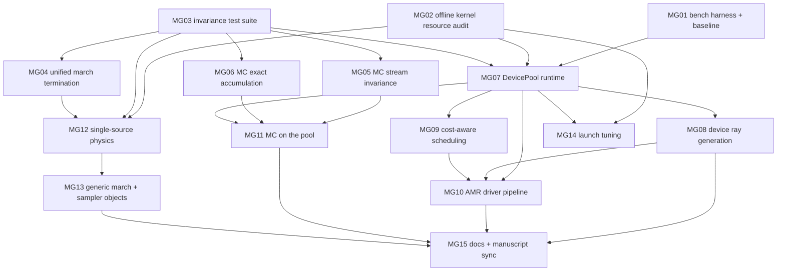

# Multi-GPU efficiency: node DAG

This file lists the node DAG for `design.md`. The ledger paper id is
`arxiv-blp-multigpu`. Every node is recorded with status `hypothesis`.

Each node carries two acceptance tests:

- a **CPU acceptance** test that runs on this host without a GPU (the
  KernelAbstractions (KA) CPU backend, or the offline `ptxas` audit);
- a **GPU acceptance** test that runs when CUDA is functional again,
  measured with the `MG01` harness under the protocol in `design.md` §7.

The ordering is tests first: `MG01`–`MG03` come before any change to
production code.

The risk tiers R0–R3 follow the rubric in `design.md` §0.

## Nodes

### MG01: phase-timed multi-GPU benchmark harness and baseline (R1)

- **Predecessors:** none.
- **Goal.** Add `bench/bench_multigpu.jl`. It runs every leg of `design.md`
  §7 on 1 and 2 GPUs and prints `BENCH` and `PHASE` lines:
  - host prologue, ray generation, upload, per-device kernel busy time from
    CUDA events, download, host epilogue, per-device idle;
  - first-call JIT time;
  - bitwise 1-vs-2-GPU equality.

  It also has a diagnostic per-block `clock64` variant that measures the
  tail (F3) and the barrier share (F2). The baseline is captured on
  `3736b32`.
- **CPU acceptance.**
  - With CUDA non-functional the script exits 0 and prints one `SKIP` line
    per leg.
  - Its `BENCH`/`PHASE` parser has a unit test in `test/` that passes.
- **GPU acceptance.**
  - Produces `results/blp/multigpu/baseline_3736b32.json`.
  - Reproduces the published full-frame numbers (`docs/src/benchmarks.md`)
    within 10%, or flags them as stale.
  - Pins F1–F4, F6 and F8 to measured shares.

### MG02: offline kernel resource audit (R0)

- **Predecessors:** none.
- **Goal.** Add `bench/kernel_audit.jl`, which emits PTX for every
  production kernel for `sm_80` without a device (the recipe in `design.md`
  §0.2) and runs `ptxas -v`. It writes a registers / stack / spill table and
  has a `--check` mode that fails on any increase over the committed
  baseline.
- **CPU acceptance.**
  - Runs on this host.
  - The table includes `_fused_kernel!` at 242 registers, 2208 B stack and
    0 spill, and `_gpol_kernel!` at 255 registers with 792/880 B spill.
  - `--check` exits 0 on the baseline and non-zero on an injected
    regression.
- **GPU acceptance.** `CUDA.registers(kernel)` on device equals the offline
  count for each kernel.

### MG03: device-count / partition invariance test suite (R1)

- **Predecessors:** none.
- **Goal.** Add `test/test_multidevice_invariance.jl`, written tests first:
  - Every imaging kernel runs on the KA CPU backend, first as one partition
    and then as {2, 3, 5} interleaved, contiguous and random-chunk
    partitions. The outputs are asserted bitwise equal. Kernels covered:
    fused, K-variant, slow-light, polarized, native AMR, generic spacetime,
    and the AD kernel.
  - MC stream-assignment and reduction invariance are asserted as
    `@test_broken` until `MG05`/`MG06`.
- **CPU acceptance.** The file passes. The broken set is exactly the MC
  cases.
- **GPU acceptance.** The same suite with the CUDA backend and
  `devices = [0]` vs `[0, 1]` gives bitwise-equal outputs.

### MG04: unified march termination (R3)

- **Predecessors:** `MG03`.
- **Goal.** One shared termination policy, called by `trace_rays_sampled`,
  the CPU marches and all fused kernels:
  - `HORIZON_EPS_SAMPLED` everywhere instead of the literal `1e-3`;
  - one near-horizon frame-fidelity / redshift stop.

  This resolves C4 and C5.
- **CPU acceptance.**
  - On a near-horizon deck, the CPU polarized march and the KA-CPU polarized
    kernel integrate the same emitting-segment set.
  - In `:mixed`, the drift stop fires only at r − r_h < δ, with δ from the
    test.
  - Pinned outputs are re-baselined with a delta report.
  - The CPU–GPU polarized correlation on the KA CPU backend is ≥ its
    current value.
- **GPU acceptance.**
  - The same tests pass with the CUDA backend.
  - The production-deck image changes by at most the documented delta.

### MG05: MC stream invariance (R3)

- **Predecessors:** `MG03`.
- **Goal.**
  - Streams are keyed by the global photon id with a domain-separated key
    word: primary, or child plus layer.
  - Children are keyed by (parent id, event index), never by atomic slot.
  - CPU child keys are independent of chunking.
  - KA-portable atomics let the MC kernels run on the KA CPU backend.
  - Scatter layers flush in chunks instead of dropping children.

  This resolves C1, C2, C10 and the CPU half of C3.
- **CPU acceptance.**
  - The MC kernels run on the KA CPU backend.
  - With `MG06`, spectra are bitwise identical for `nthreads` ∈ {1, 4, 16}
    and for {1, 2, 5} virtual devices.
  - A 5-device key-collision test passes.
  - The existing statistical gates in `test_mc_*` are unchanged.
- **GPU acceptance.**
  - Two runs with the same seed are bitwise equal.
  - 1-GPU and 2-GPU outputs are bitwise equal (after `MG11`).

### MG06: exact MC accumulation (R3)

- **Predecessors:** `MG03`.
- **Goal.** An order-independent, exact two-level Int64 fixed-point binned
  accumulator for the spectrum bins and scatter diagnostics, used on the CPU
  and on the device. This resolves C3.
- **CPU acceptance.**
  - Accumulating 10⁶ random weights in 100 random orders gives
    bitwise-identical totals.
  - The relative error against a `BigFloat` reference is ≤ 1e-15.
  - MC physics gates are unchanged.
- **GPU acceptance.** MC throughput overhead against float atomics is ≤ 3%.

### MG07: DevicePool runtime (R3)

- **Predecessors:** `MG01`, `MG02`, `MG03`.
- **Goal.** Build the runtime of `design.md` §5.1:
  - persistent per-device workers started with `Threads.@spawn`;
  - backend-generic, with KA CPU virtual devices for tests;
  - a residency cache;
  - pinned staging;
  - a fixed-size chunk queue with double buffering;
  - concurrent warm-up;
  - one `march!` executor and one `select_devices`.

  All `render_gpu_*`, `march_rays_gpu_*` and `trace_shadow_gpu` become thin
  wrappers over it. This resolves F1 (orchestration part), F5 and F8.
- **CPU acceptance.**
  - The `MG03` suite passes through the pool with 1–5 virtual devices.
  - A stress test (random chunk sizes, injected worker delays) stays bitwise
    invariant.
  - The public method signatures are unchanged.
  - `MG02 --check` passes, since kernel bodies are untouched.
- **GPU acceptance.**
  - At 768² unpolarized, the non-kernel wall time is ≤ 5% of T₂.
  - Interim S₂ is ≥ 1.85.
  - Outputs are bitwise equal to the baseline.

### MG08: device-side camera ray generation (R2)

- **Predecessors:** `MG07`.
- **Goal.** Generate camera rays in-kernel from the pixel index or block
  coordinates, with `camera_rays_at` as the single isbits source. This
  removes the 82 ms at 768² of serial host work and the 38 MB upload (F1).
- **CPU acceptance.**
  - Rays generated on the KA CPU backend equal the host `camera_rays`
    bitwise.
  - The KA-CPU images are bitwise unchanged.
- **GPU acceptance.**
  - Device rays are within 2 ulp of host rays, component-wise.
  - Ray generation plus upload is ≤ 0.5% of the frame time.
  - 768² full frame reaches S₂ ≥ 1.90.
  - 1-GPU and 2-GPU outputs are bitwise equal.

### MG09: cost-aware scheduling (R2)

- **Predecessors:** `MG07`.
- **Goal.**
  - Longest-processing-time-first ordering of tiles by predicted cost:
    critical-curve distance, parent-level trip counts, previous-frame trip
    counts.
  - `:mixed` rescue pixels enqueued first as fp64 items, with no second
    sweep.
  - `march_sort_order` semantics documented for makespan.

  This resolves F3 and F4.
- **CPU acceptance.**
  - Outputs are bitwise invariant under schedule permutations.
  - The cost proxy has Spearman ρ ≥ 0.7 against measured trip counts on the
    KA-CPU deck.
  - The single-queue rescue gives output bitwise equal to the current
    two-sweep splice.
- **GPU acceptance.**
  - Per-device kernel-busy fraction is ≥ 97%.
  - `:mixed` 768² reaches S₂ ≥ 1.90.
  - Measured tail share is < 3% of T₂.

### MG10: AMR driver pipeline (R3)

- **Predecessors:** `MG07`, `MG08`, `MG09`.
- **Goal.**
  - Resident fluid.
  - Rays for the device's blocks generated on the device.
  - Parallel host indicator and paint.
  - Streaming, barrier-free scheduling of refined blocks.
  - Deterministic assembly in (level, block) order.

  This resolves F2.
- **CPU acceptance.**
  - `render_amr` output (I, Q, U, V, levels, nrays) is bitwise equal to the
    current driver on synthetic decks and on CPU-Stokes decks, with 1–5
    virtual devices.
  - The host indicator and paint speed up ≥ 8× at 16 threads over the
    serial 142 ms baseline (synthetic, base 384, 2 levels).
- **GPU acceptance.**
  - The production AMR deck reaches S₂ ≥ 1.85 end to end.
  - 1-GPU and 2-GPU outputs are bitwise equal.

### MG11: MC on the pool (R2)

- **Predecessors:** `MG05`, `MG06`, `MG07`.
- **Goal.**
  - MC runs over global-id chunks on the pool.
  - Host tables are built once per call and shared.
  - Uploads are concurrent.
  - Per-chunk exact partials are merged in chunk order.

  This resolves F6.
- **CPU acceptance.**
  - Virtual-device counts 1–5 give bitwise-equal spectra.
  - A call counter shows the host table built exactly once per call.
- **GPU acceptance.**
  - At Ns = 1e7, thin reaches S₂ ≥ 1.90 and scatter reaches S₂ ≥ 1.85.
  - 1-GPU and 2-GPU outputs are bitwise equal.

### MG12: single-source physics (R3)

- **Predecessors:** `MG02`, `MG03`, `MG04`.
- **Goal.**
  - An immutable isbits `RTParams`, built from `SimCoeffConfig`.
  - One set of coefficient, decoder, tetrad and Bessel functions, shared by
    the CPU march and the kernels.
  - The Kerr closed form provided as methods on `KerrSchildCartesian`.
  - All `_gimg_*` / `_gpol_*` physics copies deleted.

  This resolves C11.
- **CPU acceptance.**
  - CPU-vs-kernel coefficient parity holds by identity.
  - The CPU render vs KA-CPU kernel render tolerances are unchanged or
    tighter.
  - Pins are re-baselined with a per-pixel delta report (max relative delta
    ≤ 1e-12).
  - `MG02 --check` passes: registers and spill bytes are ≤ baseline for
    every kernel.
- **GPU acceptance.** Fused unpolarized and polarized single-GPU throughput
  is within −2% of the `MG01` baseline.

### MG13: generic march and sampler objects (R3)

- **Predecessors:** `MG12`.
- **Goal.**
  - One unpolarized march (Float64, Dual and `SVector{K}` accumulators) and
    one polarized march, each parameterized by a spacetime object and an
    isbits sampler object (uniform, AMR leaf, AMR scan, time blend).
  - One kernel per radiative-transfer mode.
- **CPU acceptance.**
  - All existing KA-CPU kernel tests pass.
  - Outputs are bitwise equal to `MG12`'s.
  - `MG02 --check` passes.
- **GPU acceptance.**
  - Single-GPU throughput is within −2% of the baseline for every leg.
  - 1-GPU and 2-GPU outputs are bitwise equal.

### MG14: launch tuning (R1)

- **Predecessors:** `MG02`, `MG07`.
- **Goal.** Choose the workgroup size per kernel and whether to use
  `always_inline`, guided by the audit. The targets are the 2.2–3.3 KB stack
  frames and the polarized spill (F9).
- **CPU acceptance.**
  - The audit table shows lower stack or spill for the chosen
    configuration.
  - Outputs are bitwise unchanged across workgroup sizes (KA-CPU invariance
    test).
- **GPU acceptance.** Single-GPU throughput gains ≥ 5% on some leg; if no
  leg gains, the change is reverted.

### MG15: docs and manuscript sync (R1)

- **Predecessors:** `MG08`, `MG10`, `MG11`, `MG13`.
- **Goal.** Update `docs/src/benchmarks.md`, `docs/src/guide/gpu.md` and the
  manuscript evidence row E8 with the measured after-numbers from `MG01`.
  Restate the scope of MC parity and the code-sharing claims to match the
  code after `MG12`/`MG13`.
- **CPU acceptance.** `check_manuscript.py` and `check_claim.py` pass. Every
  scaling number in the docs traces to an `MG01` log line.
- **GPU acceptance.** The numbers come from `MG01` runs on the final commit.

## Which nodes need a GPU

| node | can proceed and pass CPU acceptance now | blocked on GPU for |
|---|---|---|
| `MG01` | harness and parser (CPU part) | baseline capture: **every speed claim depends on it** |
| `MG02` | **fully** (demonstrated on this host) | only the optional on-device cross-check |
| `MG03` | **fully** | CUDA-backend confirmation |
| `MG04` | implementation and all CPU tests | CUDA-backend re-run |
| `MG05`, `MG06` | implementation and all CPU tests | overhead and bitwise check on CUDA |
| `MG07` | implementation, virtual-device tests, signature checks | S₂ and host-time share |
| `MG08`, `MG09`, `MG10`, `MG11` | implementation and bitwise CPU tests | the scaling criteria (≥ 1.90 / ≥ 1.85) |
| `MG12`, `MG13` | implementation, CPU tolerance tests, register/spill guard (`MG02`) | the throughput non-regression check |
| `MG14` | audit-guided candidates | the timing decision (keep or revert) |
| `MG15` | none | fully blocked (needs `MG01` after-numbers) |

## Landed commits and reverts (lane A, CPU-verified, speed unmeasured)

Each node below passed its CPU acceptance on the KA CPU backend (`HostDevice`) and
`bench/kernel_audit.jl --check`; its ledger row is `preliminary` until the GPU
acceptance runs. Revert a node with `git revert <SHAs>` in reverse DAG order
(later nodes build on MG07's pool and MG08's device rays).

| node | commits (revert these) | CPU verification | GPU acceptance to run |
|---|---|---|---|
| `MG01` | `43bffa1` | `test/test_bench_lines.jl`; harness exits 0 with one `SKIP` per leg without CUDA; `BLP_BACKEND=cpu` smoke run bitwise 1-vs-2 equal | baseline capture from a `3736b32` worktree, `BLP_OUT=results/blp/multigpu/baseline_3736b32.json` |
| `MG07` | `bd26470` | `test/test_device_pool.jl`, `test/test_device_invariance.jl` (1/2/3/5 devices, random pools, delays) | 768² unpolarized: non-kernel time ≤ 5% of T₂, S₂ ≥ 1.85, output == baseline |
| `MG08` | `0610b31`, `d25e2e6` (audit rows) | `test/test_device_rays.jl` (device rays `isequal` host rays; images equal) | device rays ≤ 2 ulp; ray gen + upload ≤ 0.5% of frame; 768² S₂ ≥ 1.90 |
| `MG09` | `41743a1` | `test/test_device_schedule.jl` (ρ = 0.95 / 0.80; order invariance; `:mixed` == splice) | kernel-busy ≥ 97%; `:mixed` 768² S₂ ≥ 1.90; tail < 3% of T₂ |
| `MG10` | `4f5f1e3` | `test/test_device_amr.jl` (bitwise == level-synchronous driver); `bench/bench_amr_host.jl` 9.3–9.6× at 16 threads | production AMR deck S₂ ≥ 1.85 (`amr_driver_pol` leg, streamed) |
| `MG11` | `c4895d2` | MC-on-pool set in `test/test_device_invariance.jl`; `test/test_mc_exact.jl` | Ns = 1e7: thin S₂ ≥ 1.90, scatter S₂ ≥ 1.85, 1-vs-2 GPU equal |

Kernel signatures are unchanged by these nodes; the only new kernel is
`_camray_kernel!` (MG08).
