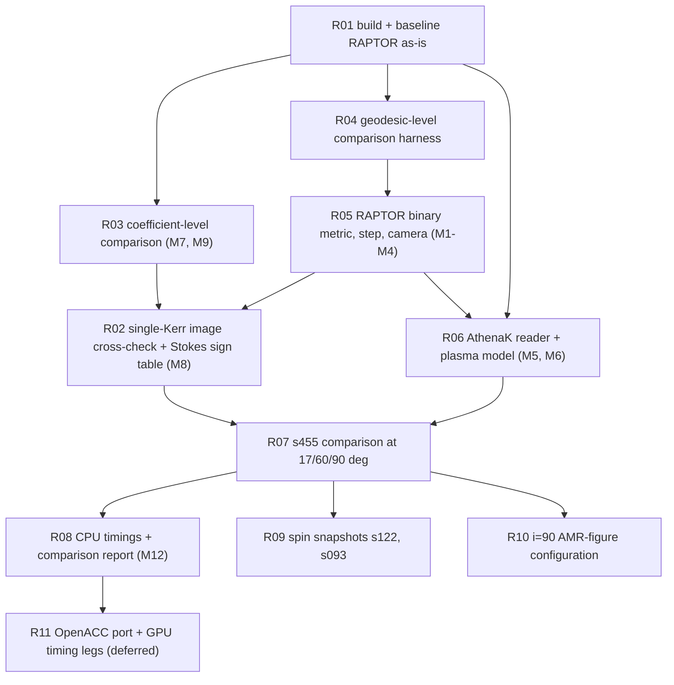

# RAPTOR vs BlackLightPlus: node DAG

This file lists the nodes that implement `design.md`. The ledger paper id is
`arxiv-1801.10452`, and every node is recorded with status `hypothesis`.
Nodes are ordered tests-first: R03, R04 and R06 define the unit comparisons
that the RAPTOR modifications must pass before any image is compared.

Conventions used throughout:
- Modification ids M1–M13 and convention rows C1–C35 refer to `design.md`
  §4 and §3.
- Run directories live under `out/raptor/<node>/`, which is ignored by git.
- Tracked evidence goes to `results/blp/raptor/evidence/<node>/`.
- Every RAPTOR commit is exported to `results/blp/raptor/patches/` (`fork.md`).

The CPU legs run on this host. The GPU legs are specified in R11 and deferred
until CUDA works again (the host currently reports an NVML error).

## R01 build + baseline RAPTOR as-is

- **Work.**
  - Pin the upstream commit, create branch `blp-bbh` and export the (empty) patch series.
  - Build with gcc/`h5cc` and with `nvc -mp`.
  - Run the upstream code on a reference snapshot. The official tutorial `data2000.dat` is unreachable, so the reference is the synthetic BHAC snapshot `tools/make_bhac_synthetic.py`.
  - Reassemble the HDF5 image with `tools/raptor_h5_to_array.py`.
- **Acceptance.**
  - Both builds exit 0.
  - The run exits 0 and writes `img_data_0.h5` and the spectrum.
  - The reassembled image sum equals the spectrum-file flux to ≤ 1e−6.
  - nvc and gcc fluxes agree to ≤ 1e−4.
- **State at decomposition** (`design.md` §1.1): all acceptance items are met. Measured:
  - gcc 1.37395e−06 Jy;
  - reassembled sum 1.373951e−06 Jy;
  - nvc 1.37405e−06 Jy, which is Δ = 7.3e−5.
- **[OPEN]** Run the upstream tutorial (expected 3.63027 Jy) when `astro.ru.nl` is reachable.

## R03 coefficient-level comparison

- **Tests first.** Write a C driver that links the fork's `pol_emission.c`, and a Julia script that calls BLP `coefficients.jl`. Both evaluate (j_I, j_Q, j_V, α_I, α_Q, α_V, ρ_Q, ρ_V) on the same table:
  - ν_fluid ∈ {86, 230, 345} GHz × {0.3, 1, 3};
  - n_e = 1e5 cm⁻³, B ∈ {1, 10, 100} G;
  - Θ_e ∈ 10^[−2.5, 2.5] (41 points), θ_B ∈ (0, π) (37 points, excluding exactly 0 and π).
- **Work.**
  - M7 (`EMIS_BLP` port, with the Q-type sign flip into RAPTOR's e₁ ⟂ B basis).
  - M9 (BLP constants).
- **Acceptance.**
  - `EMIS_BLP` against BLP: max relative difference ≤ 1e−10 for every coefficient where |value| > 1e−300. Signs follow C25.
  - `EMIS_NATIVE` against BLP: a report only. For each coefficient, give the ratio distribution (median, 5–95%, worst cell) and the Θ_e and X ranges where the ratio leaves [0.9, 1.1].
  - Constants: the unmatched set changes L_unit by the documented 2.2e−4, and the RAPTOR flux scale by the corresponding factor.
- **Evidence.** `evidence/R03/coeff_table.csv`, `evidence/R03/summary.json`.

## R04 geodesic-level comparison harness

- **Tests first.** A ray-dump interface in both codes, run on the same initial rays:
  - RAPTOR: `integrate_geodesic` writes (λ, x^μ, k^μ, h) per step.
  - BLP: `trace_rays_sampled` writes (λ, x^μ, p_μ, h).

  The legs:
  - **Kerr** (a = 0.9375, one hole at the origin, SKS with N = 1);
  - **SKS s455** geometry (a_A = 0, C₁ = −C₂ from `design.md` §2);
  - **SKS s122** geometry (a_A = 0.4).

  Each leg uses 1000 rays: 400 on a 20² grid inside FOV 56, 600 random, and 50 near the critical curves.
- **Comparisons.**
  1. **Metric.** For RAPTOR g, g⁻¹ and Γ (FD M2a, analytic M2b) against BLP g and AD ∂g at 1e4 points:
     - |g − g_BLP| ≤ 1e−14;
     - |g g⁻¹ − I| ≤ 1e−13;
     - Γ(M2b) against the AD-derived Γ ≤ 1e−12 (relative);
     - Γ(M2a) against the AD-derived Γ ≤ 1e−7 (relative).
  2. **Trajectories.** Fixed-step RK4 with C ∈ {20, 40, 80, 160}:
     - both codes converge to a BLP Vern7 reference (reltol 1e−12) with observed order ≥ 3.5 in max |Δx| before the closest approach;
     - at C = 80, max |x_R − x_B| ≤ 1e−3 M on escaping rays, compared at equal λ;
     - the termination class (captured by A, captured by B, escaped, step budget) is identical on ≥ 99.9% of rays;
     - the escape direction agrees to ≤ 1e−6 rad.
  3. **Null norm.** |k·k|/k_t² ≤ 1e−8 along every ray at C = 80.
  4. **Samples.** RAPTOR's RT loop uses states 1…steps−1, each with dl[n−1] (`rte_integrator.c:49-55`). This must equal the set BLP marches (`reverse_march.jl:142-168`), counted per ray.
- **Acceptance.**
  - The Kerr leg must pass for the M1–M3 build with N = 1.
  - The SKS legs are the acceptance test of R05.
  - The upstream CKS Kerr is reported against the same reference. Its regulariser error is expected to be about 1e−4 at r ≈ 4 (`design.md` §1.2).
- **Evidence.** `evidence/R04/{metric,rays,termination}.json`, plus plots of the convergence order.

## R05 RAPTOR binary metric, step control and camera

- **Work** (commits on `blp-bbh`):
  - M1 (SKS metric, `bbh.in`);
  - M2a and M2b (FD and analytic derivatives);
  - M3 (BLP step and termination);
  - M4 (plane-parallel camera).
- **Acceptance.**
  - All R04 SKS legs pass.
  - The camera states agree: for 480² pixels at i = 17, 60, 90, RAPTOR's initial (x^μ, k_μ) equals BLP `camera_rays` to ≤ 1e−14.
  - Upstream behaviour is unchanged when the new switches are off: the R01 synthetic image is bitwise identical.
- **Evidence.**
  - `evidence/R05/camera_diff.json`;
  - the R04 JSON files re-run on the fork head;
  - `patches/SERIES`.

## R02 single-Kerr image cross-check and Stokes sign table

- **Tests first.** Both codes run the same analytic scenes with the same camera (M4), metric (M1 with N = 1) and coefficients (M7):
  1. **Thin-slab orientation tests.** These are BLP `test/test_ray_orientation.jl` scenes, reproduced as RAPTOR model plug-ins:
     - B north gives Q < 0;
     - B north-west gives U > 0;
     - B toward the observer gives V > 0;
     - a Faraday screen rotates χ east.
  2. **The BLP driver's orientation self-test** (Kerr a = 0.9, prograde ring, vertical field): east/west ratio 2.543, Q/I = −0.650, U/I = +0.240, EVPA 79.9° (`figures/out/eht_bbh/index.json`).
  3. **The Gold+2020 analytic-model test problem** (camera at 1000 M, FOV 30 M, 128² and 480², i = 17°, 60°, 90°).
- **Work.** M8: derive RAPTOR's (e₁, e₂, k) handedness from test 1 and implement the IEEE/IAU readout.
- **Acceptance.**
  - Tests 1 and 2 have identical signs.
  - Test 2 agrees within 1% on ratios and 0.5° on EVPA.
  - Test 3, at C = 160 and 480²:
    - NMSE(I) ≤ 1e−4 (Gold+2020 RAPTOR against exact: 7e−5 to 1.5e−4);
    - total flux within 0.1%;
    - normalized L1 ≤ 1% for I and ≤ 3% for |P| and V;
    - net EVPA within 0.5°.
- **Evidence.** `evidence/R02/{orientation,analytic}.json`, and I/Q/U/V difference maps (PNG, not tracked).

## R06 AthenaK reader and plasma model

- **Tests first.** At the same 1e5 points, BLP `sample_primitives` and the RAPTOR `get_fluid_params` probe are compared. The points are:
  - uniform in R < 60;
  - concentrated at block faces and level jumps;
  - 1e3 inside each AthenaK excision radius;
  - a few outside the mesh.

  The snapshots are s455 (`.bin`), s122 (`.athdf`) and, after R09 memory checks, s093.
- **Work.**
  - M5: reader with Float32 storage, a per-level hash, the BLP ownership rule and cell-centred trilinear interpolation.
  - M6: plasma model.
- **Acceptance.**
  - The owning block is identical at every point.
  - Interpolated primitives agree to ≤ 1e−6 relative.
  - u^μ, b^μ, n_e, B, Θ_e, σ and β agree to ≤ 1e−6 relative, with u·u = −1 and u·b = 0 to 1e−10.
  - The inside flag and the σ-cut flag are identical.
  - s455 load: memory ≤ 1.1 × the file size; the load time is reported next to BLP's 3.6 s.
- **Evidence.** `evidence/R06/{s455,s122}_samples.json`.

## R07 s455 comparison at i = 17°, 60°, 90°

- **Setup.**
  - s455, R_high = 40, R_low = 1, ms = 2.274019497e28 g;
  - M = 1.3e10 M_sun, D = 16.8 Mpc, 230 GHz;
  - FOV 56 M, 480², d = 1000;
  - C = 80, nmax = 4000; polarized.

  Legs:
  - **(a) Matched.** M1–M9 with RAPTOR's native polarized solver.
  - **(b) Matched solver.** (a) plus M11 (LD85).
  - **(c) Native fits.** (a) with `EMIS_NATIVE`.
  - **(d) Native step.** (a) with the native `stepsize()`, STEPSIZE ∈ {0.02, 0.01, 0.005}.

  Convergence of both codes over C ∈ {40, 80, 160} and 240/480/960 pixels at i = 17° (plus C only at 60° and 90°).
- **Acceptance** for leg (b), and for leg (a) after convergence:
  - total flux within 1% (0.5% after Richardson extrapolation);
  - normalized L1(I) ≤ 3% and NMSE(I) ≤ 1e−3;
  - net linear polarization fraction within 0.01 absolute, ⟨|m|⟩ within 0.01;
  - EVPA_net within 2°; v_net within 0.002 absolute;
  - per-hole ring diameter within 0.5 µas (native and 20 µas blur);
  - f_C within 0.02;
  - at i = 90° the pair is flagged unresolved in both codes (7.1 M projected);
  - every remaining difference satisfies the attribution rule (`design.md` §5), or is opened as an error-ledger row.

  Leg (c) reports the fit-induced differences in flux, m, v and EVPA. There is no threshold; it is compared with R03's ratio table.
- **Evidence.**
  - `evidence/R07/metrics.json`, a table per leg, inclination and resolution;
  - `.npy` images in `out/raptor/R07/` (not tracked);
  - error maps as PNG.

## R08 CPU timings and comparison report

- **Work.** M12: OpenMP over all pixels plus phase timers. The R01 synthetic image must stay bitwise identical.
- **Timing protocol.**
  - Same host, idle.
  - Thread counts {1, 16, 64, 128}, with pinning `OMP_PROC_BIND=close`, `OMP_PLACES=cores` and `JULIA_NUM_THREADS` equal to the OMP count.
  - Three repeats; report the median.
  - Phases: load, camera, trace, polarized RT.
  - s455 at i = 17°, 480², C = 80. Both codes use the same ray count and step control.

  Report rays/s, samples/s and the strong-scaling efficiency. BLP JIT time is excluded and reported separately.
- **Report.** `results/blp/raptor/report.md` (rendered from `evidence/`), with:
  - figures: side-by-side I/Q/U/V, difference maps, convergence curves, timing bars;
  - the convention table outcome;
  - attributed residuals.
- **Acceptance.** Every number in the report traces to an evidence JSON; the timing table covers both codes at each thread count.

## R09 spin snapshots s122 and s093

- **Setup.**
  - As R07, with a_A = 0.4 (χ = 0.8) along +z, and φ₀ and centres from `design.md` §2.
  - Mass scales: s122 1.000498515e21 g, s093 2.252873787e20 g.
  - s093 requires the M5 Float32 layout (about 35 GB).
  - 28–46% of the s093 flux falls outside the 56 M field of view. That is identical in both codes, but noted.
- **Acceptance.**
  - The R07 thresholds, at i = 17°, 60°, 90°.
  - s093 peak memory ≤ 64 GB.
  - Load time reported next to BLP's 25.9 s.

## R10 i = 90° AMR-figure configuration

- **Setup** (`figures/fig_bbh_i90_pol_amr.jl`):
  - s455; φ₀ = −0.2233022; centres ±12.5 (cos φ₀, sin φ₀);
  - γ = 13/9; M = 6.5e9 × 1.989e33 g total;
  - ms = 1e24 g; R_high = 10;
  - FOV 40, i = 90°, nmax 2500.

  BLP is re-run at HEAD, because the recorded run is at bb233b2 with 34 differing `src/` files.
- **Comparison.**
  - Uniform 1024² images from both codes.
  - BLP's AMR image (effective 4096²), block-averaged to 1024², against the RAPTOR uniform 1024².
  - A 4096² RAPTOR image of the central 10 M × 10 M window, where the AMR refines most.
- **Acceptance.**
  - Uniform 1024²: the R07 thresholds.
  - AMR against uniform: normalized L1 ≤ 3% over the full frame.
  - LP fraction (BLP record: 0.843) within 0.01.

## R11 OpenACC port and GPU timing legs (deferred)

- **Work.** M13: remove the function pointers, recursion and hot-loop `malloc`; move the Bessels to the device; `#pragma acc parallel loop` over pixels.
  1. Build with `nvc -acc=multicore` and check bitwise or ≤ 1e−12 agreement with the CPU fork on R07 leg (a).
  2. Build with `-acc=gpu -gpu=cc80` once a device is usable.
- **GPU timing legs.** Both codes on one A100 80 GB:
  - BLP fused kernels (`:mixed` and fp64);
  - RAPTOR OpenACC in fp64.

  Measurements:
  - s455 480² and 1024², i = 17°: time to image, rays/s, H2D snapshot upload time, device memory;
  - 2-GPU scaling for BLP only (RAPTOR has no multi-GPU path).
- **Acceptance.**
  - The multicore build matches the CPU fork.
  - The GPU images match the CPU fork to ≤ 1e−10 (fp64).
  - The timing table holds medians of 3 runs, with the protocol of R08.
- **Blocker.** No usable GPU on this host (NVML error). The deferral is recorded on the ledger row.
